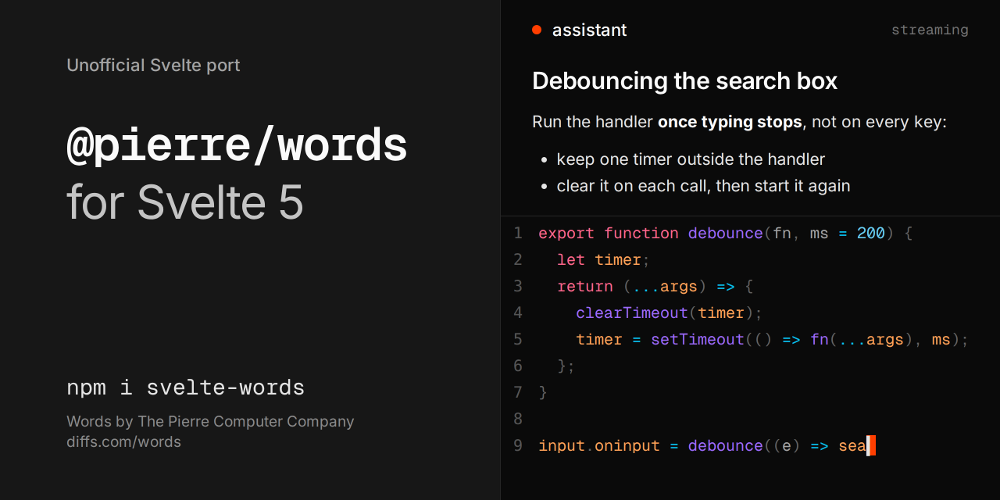

<div align="center">



# Words for Svelte

A Svelte 5 port of Pierre's [Words](https://diffs.com/words) ([`@pierre/words`](https://github.com/pierrecomputer/pierre/tree/main/packages/words)),
the streaming Markdown renderer by The Pierre Computer Company.

Unofficial; not affiliated with or endorsed by Pierre.

[](https://github.com/Bewinxed/svelte-words/actions/workflows/ci.yml)
[](https://github.com/Bewinxed/svelte-words/actions/workflows/upstream.yml)
[](https://www.npmjs.com/package/svelte-words)
[](https://www.npmjs.com/package/svelte-words)
[](https://www.npmjs.com/package/svelte-words?activeTab=code)
[](https://github.com/Bewinxed/svelte-words/blob/main/LICENSE)
[](https://svelte.dev)
[](https://diffs.com/words)

</div>

Words is Pierre's: it parses CommonMark, GFM and footnotes in WebAssembly,
writes the result into the DOM and patches it in place as the text grows, so a
reply streamed a few words at a time rewrites only what changed. This package
is the Svelte layer over it: a `<Markdown>` component and a `markdown`
attachment, with your own snippets drawing links, images, code spans and code
blocks, mounted in place and kept, with their state, while the text around
them streams.

```sh
npm install svelte-words @pierre/words
```

| svelte-words | @pierre/words | svelte  |
| ------------ | ------------- | ------- |
| 0.1.x        | 0.2.x         | ≥ 5.40  |

## Credits

Words, and everything that makes it fast, is the work of
[The Pierre Computer Company](https://github.com/pierrecomputer/pierre)
([`@pierre/words`](https://github.com/pierrecomputer/pierre/tree/main/packages/words),
Apache-2.0; demo and docs at [diffs.com/words](https://diffs.com/words)).

**Pierre's:** the Markdown parser and the renderer, in WebAssembly; the DOM
patching that makes streaming cheap, with its caret, fades and repair of
unfinished syntax; code highlighting (`@pierre/words/highlights` on
`@pierre/highlights`); math; the Mermaid plugin (`@pierre/words/mermaid`,
drawing with Pele); the styles; and the benchmarks behind its speed claims.

**Ours:** the Svelte glue only. The `<Markdown>` component and the `markdown`
attachment over Words' `createDomRenderer` and `createHtmlRenderer`; your
snippets mounted in place of links, images, code spans and code blocks;
defaults through Svelte context; and server rendering with hydration. No
source of Pierre's is copied here; Words is a peer dependency you install
yourself.

## A message

```svelte
<script lang="ts">
  import { Markdown } from "svelte-words";

  let { text, streaming }: { text: string; streaming: boolean } = $props();
</script>

<Markdown source={text} {streaming} animated class="prose" />
```

Pass the whole text so far as `source` on every update, and `streaming` while
more of it is coming. While it streams, unfinished emphasis, code and links
are completed for display (`repair`, on by default); once it stops, the text
renders as written.

Every other attribute (`class` with Svelte's arrays and objects, `id`,
`aria-*`, an `{@attach}`) goes on the root, a `<div data-markdown="root">`.

## Your markup in the output

Give a snippet for a kind of element and it is drawn in that element's place:
`link`, `image`, `inlineCode`, or `code` for a fenced block. `when` narrows a
snippet to some of its elements; Words draws the rest.

```svelte
<script lang="ts">
  import { Markdown, type CodeOptions, type MarkdownLink } from "svelte-words";
  import CodeBlock from "./CodeBlock.svelte";
  import UserChip from "./UserChip.svelte";

  let { text, streaming } = $props();

  const urlTransform = (url: string) =>
    url.startsWith("app:user/") || /^https?:/.test(url) || !url.includes(":") ? url : null;
</script>

{#snippet code({ code, language, isIncomplete }: CodeOptions)}
  <CodeBlock {code} {language} live={isIncomplete} />
{/snippet}

{#snippet link({ href, text }: MarkdownLink)}
  <UserChip id={href?.slice("app:user/".length)} label={text} />
{/snippet}

<Markdown
  source={text}
  {streaming}
  {code}
  {link}
  when={{ link: ({ href }) => !!href?.startsWith("app:user/") }}
  options={{ urlTransform }}
/>
```

| Snippet      | Receives                                                                     |
| ------------ | ---------------------------------------------------------------------------- |
| `link`       | `{ href: string \| null, title: string \| null, html: string, text: string }` |
| `image`      | `{ src: string, alt: string, title: string \| null }`                        |
| `inlineCode` | `{ code: string }`                                                           |
| `code`       | Words' `CodeOptions`: `{ code: string, language: string, isIncomplete: boolean }` |

- A snippet is mounted once for its element and given new values as the
  element changes: a code block streaming line by line keeps one mounted
  component from its first line to the end of the stream. It is unmounted
  when its element goes away, and when the markdown is destroyed.
- Snippets are drawn in the context of the component that renders
  `<Markdown>`, so components inside them read its context.
- `html` is the link's content as the escaped HTML Words wrote, safe for
  `{@html}`.
- A link or image snippet receives the URL your `urlTransform` returned, even
  one Words' own check refuses (an app's own scheme, as above). Check or
  escape it as you draw it. Words draws every other link, and checks it.
- A code block's `code` is its lines, each ending in a line feed, and its
  `language` is `text` for a fence that names none, as Words gives them.

## Props

| Prop                                  | Default | What it does                                                                                  |
| ------------------------------------- | ------- | --------------------------------------------------------------------------------------------- |
| `source`                              |         | The whole markdown so far.                                                                    |
| `streaming`                           | `false` | More of the source is coming.                                                                 |
| `repair`                              | `true`  | Complete unfinished syntax while streaming.                                                   |
| `animated`                            | `false` | Words' fade of the text a stream adds: `true` or `{ duration }`.                               |
| `caret`                               |         | Words' `'block'` or `'circle'` caret at the end while streaming.                              |
| `options`                             |         | Words' renderer options (`HtmlOptions`), passed to Words as they are.                         |
| `link`, `image`, `inlineCode`, `code` |         | Snippets, above.                                                                              |
| `when`                                |         | Per snippet, which elements it takes.                                                         |

`options` is Words' own `HtmlOptions` type: `components`, `plugins`,
`urlTransform`, `math`, `cjk`, `controls`, `lineNumbers`, `allowedElements`,
`disallowedElements`, `unwrapDisallowed`, `idPrefix`, and whatever a later
Words adds. Each `<Markdown>` gets its own `idPrefix` unless you give one.

Everything is read reactively: change a prop and the output follows, rendered
again only when a value changed. Nothing needs to be memoized. A new hook
function applies to the output written after it, as in Words.

Fades and the caret are drawn by Words' stylesheet; import
`@pierre/words/styles.css` for its look, or write your own rules for
`[data-markdown][data-animated="true"]` and `[data-markdown="caret"]`. Text
already on screen when the element first renders never fades. When the stream
ends, its last words fade in too, and the fades still running finish before
the stream is marked as stopped.

## Mermaid diagrams

Words draws `mermaid` fences with [Pele](https://pele.run), which you install
and pass in through `options.plugins.mermaid`. This package imports neither
Pele nor `@pierre/words/mermaid`, so markdown without diagrams ships none of
it.

```sh
bun add pele
```

```svelte
<script lang="ts">
  import { createMermaidPlugin } from "@pierre/words/mermaid";
  import { render } from "pele";
  import { Markdown } from "svelte-words";

  const mermaid = createMermaidPlugin({ render }, { links: false });
  let { text, streaming } = $props();
</script>

<Markdown source={text} {streaming} options={{ plugins: { mermaid } }} {code} />
```

Create the plugin once, outside the render: Words compares it by identity
and draws every diagram again when it changes. The second argument is Pele's
render options.

- While the fence is open, the diagram grows with each complete line, and a
  line that does not parse keeps the last diagram that did. An open fence
  with no diagram yet shows nothing.
- A closed fence that does not parse is code: your `code` snippet draws it,
  as it draws every other fence (`when.code` still chooses), and Words draws
  it when you have none.
- Your `code` snippet never receives a diagram Pele draws.
- Words puts a diagram in its code block frame: a header naming `mermaid`
  and, unless `controls` is off, its Copy and Download buttons. Style or hide
  `[data-markdown="code-block"][data-language="mermaid"] > [data-markdown="code-header"]`.
  The diagram itself is `[data-markdown="mermaid"]`; theme it with Pele's
  `--pele-*` variables.

### Loading Pele when a diagram appears

`import { render } from "pele"` puts every diagram type in your bundle.
`pele/lazy` loads each type on demand, but Words calls the plugin
synchronously, so the plugin has to draw a type it is still loading as
something (here, an empty diagram) and be replaced once the type is in. This
module loads Pele the first time a source holds a mermaid fence, and each
type the first time it is drawn:

```ts
// mermaid.svelte.ts
import { createMermaidPlugin } from "@pierre/words/mermaid";
import type { MermaidPlugin } from "svelte-words";

type Pele = typeof import("pele/lazy");

const MERMAID_FENCE = /^ {0,3}(?:`{3,}|~{3,})[ \t]*mermaid\b/mu;

let pele: Promise<Pele> | undefined;
let plugin = $state<MermaidPlugin>();
const asked = new Set<string>();

function pluginOf(lazy: Pele): MermaidPlugin {
  return createMermaidPlugin(
    {
      render(code, options) {
        let type: ReturnType<Pele["detectType"]> = null;
        try {
          type = lazy.detectType(code);
        } catch {}
        if (type !== null && !lazy.registered(type)) {
          if (!asked.has(type)) {
            asked.add(type);
            lazy.load(type).finally(() => {
              plugin = pluginOf(lazy);
            });
          }
          return { svg: "" };
        }
        return lazy.render(code, options);
      },
    },
    { links: false, images: false }
  );
}

/** The plugin for `source`: none until it holds a mermaid fence and Pele is in. */
export function mermaidFor(source: string): MermaidPlugin | undefined {
  if (pele === undefined && MERMAID_FENCE.test(source)) {
    pele = import("pele/lazy");
    pele.then((lazy) => {
      plugin = pluginOf(lazy);
    });
  }
  return plugin;
}
```

```svelte
<Markdown source={text} {streaming} options={{ plugins: { mermaid: mermaidFor(text) } }} {code} />
```

Until Pele is in, a mermaid fence is code. Bundlers split `pele/lazy` and each
diagram type into chunks of their own.

## Defaults for a subtree

```svelte
<script lang="ts">
  import { setMarkdownDefaults } from "svelte-words";
  import { highlighting } from "./highlighting";

  setMarkdownDefaults({ options: { plugins: highlighting, controls: false }, animated: true });
</script>
```

Every `<Markdown>` under this component starts from these (snippets included),
each prop it is given overriding them, its `options` merged over theirs. A
nested call merges over its ancestor's.

## The attachment

`<Markdown>` is a `<div>` with the `markdown` attachment on it. Put the
attachment on an element of your own:

```svelte
<script lang="ts">
  import { getAllContexts } from "svelte";
  import { markdown } from "svelte-words";

  let { text, streaming } = $props();
  const context = getAllContexts();
</script>

<article {@attach markdown(() => ({ source: text, streaming, animated: true, context }))}></article>
```

The function is read in an effect, so whatever it reads is tracked. Pass
`context` when snippets read context.

## Server rendering

`<Markdown>` writes its HTML on the server, and on hydration the attachment
adopts it: the server's nodes stay, and the snippets mount in their places.
Until then each snippet's element reads as Words writes it.
`renderMarkdown(input)` returns that HTML on its own, for an element the
attachment takes over later.

## Updating Words

`@pierre/words` is a 0.x release, so each of our releases names the Words
minor it supports (above) and the peer range holds to it (`^0.2.2` is 0.2.x).

- `src/words.ts` is the only module that imports `@pierre/words`, and only its
  public `@pierre/words/html` entry. A Words release that moves something is
  fixed there.
- Words' options are its own types (`HtmlOptions`, `CodeOptions`,
  `AnimateOptions`), passed through untouched: an option a new Words adds
  works with no release of ours.
- The snippets ride on Words' documented hooks: `components` for links,
  images and code spans, `plugins.renderers` for fenced blocks, your
  `plugins.mermaid` for a diagram it shows as code, and `urlTransform`.
- CI runs the build, `svelte-check`, `publint` and the tests on every push,
  and daily against `@pierre/words@latest`, so a Words release that breaks
  something shows up before anyone upgrades. Dependabot opens the bump.

To move to a new Words: bump the dev dependency and the peer range, run
`bun run verify`, fix `src/words.ts` if it fails, and add the row to the table
above.

## Development

```sh
bun install
bun run verify   # build, svelte-check, publint, tests
```

## Releasing

CI publishes to npm; nobody publishes by hand. Bump `version` in
`package.json`, add its `CHANGELOG.md` entry, commit, then tag and push:

```sh
git tag v0.1.1 && git push origin main v0.1.1
```

The `Publish` workflow checks that the tag matches the version, runs
`bun run verify`, and publishes through npm's trusted publishing (OIDC, no
token), with a provenance attestation.

## License

MIT
